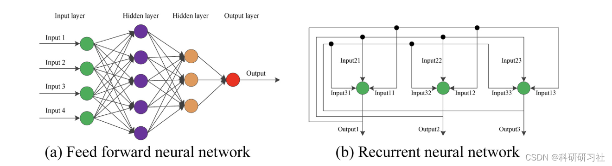
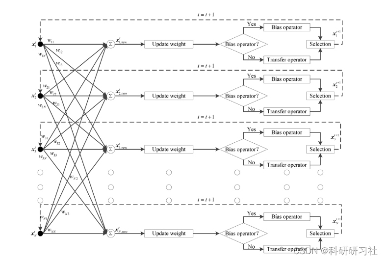
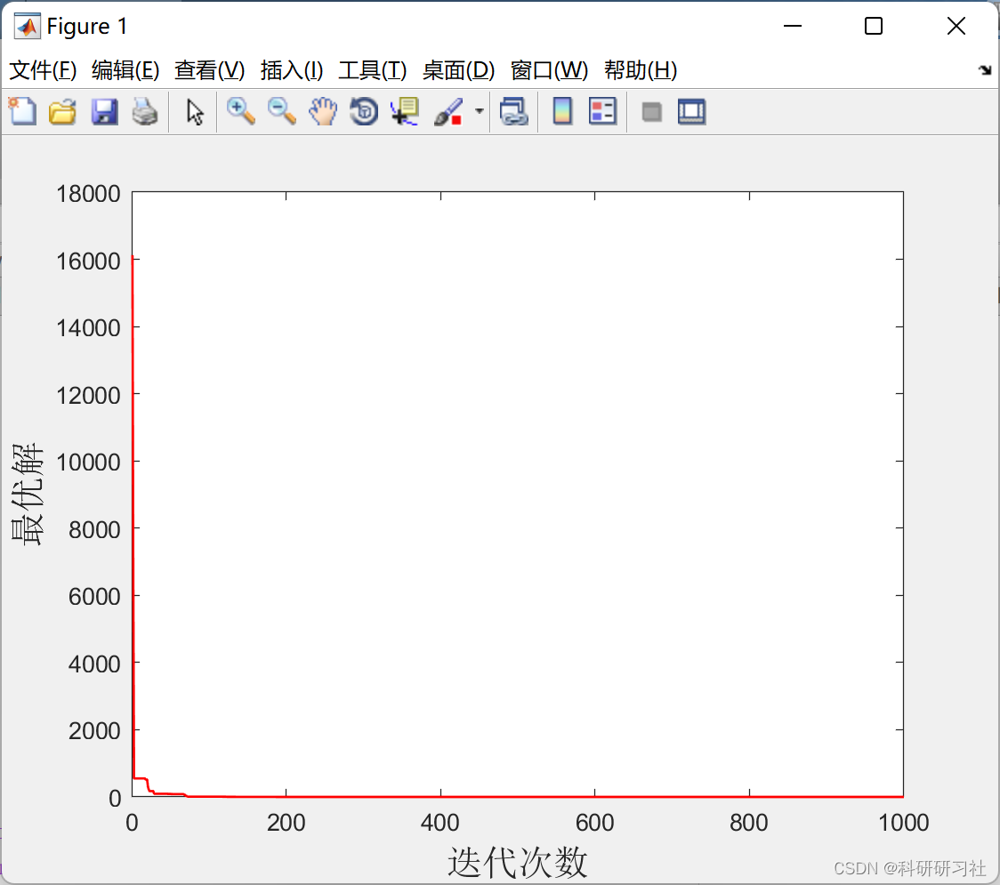
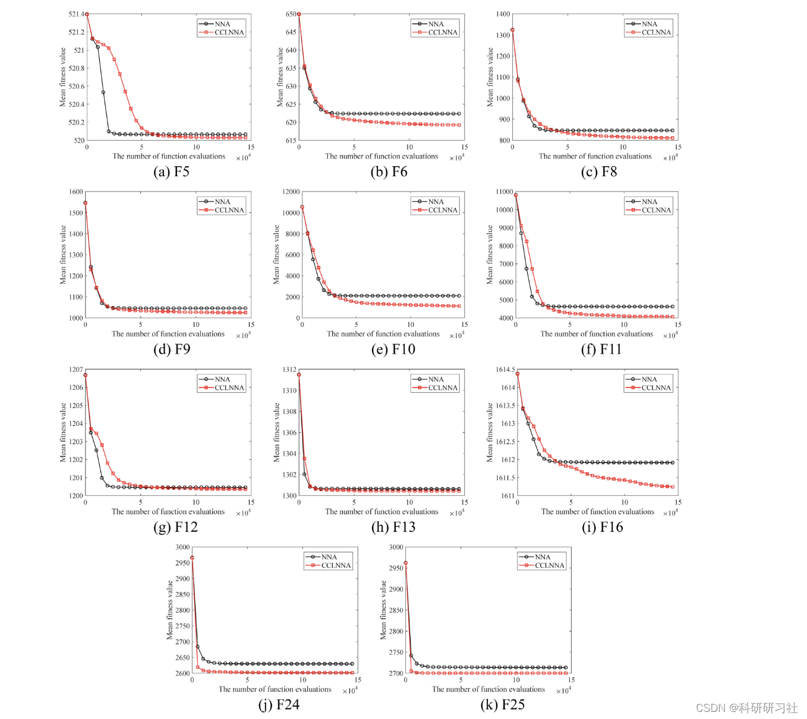
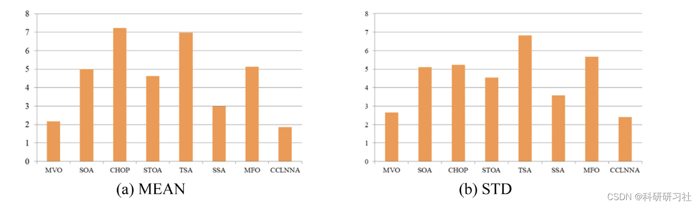
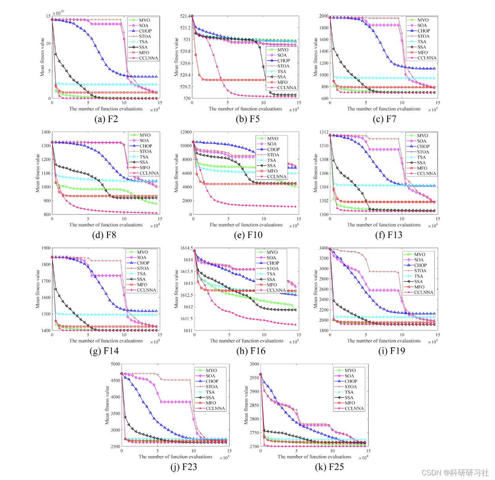

# Chaotic Neural Network Algorithm Based on Competitive Learning for Global Optimization (Matlab Code Implementation)

Deterministic methods typically rely on numerical linear and nonlinear programming approaches that require substantial gradient information and seek to improve solutions near the initial starting point [15,16]. It is important to note that the performance of deterministic algorithms has become highly dependent on the chosen starting point. For deterministic algorithms, once the starting point is fixed, the solution obtained is already determined. In fact, most real-world optimization problems are highly complex, with their objective functions often referring to multiple local optima and exhibiting nonlinear characteristics [17]. Considering the sensitivity of starting points, deterministic algorithms tend to fall into local optima to solve complex real-world problems [16,18,19]. Compared to deterministic algorithms, metaheuristic algorithms do not rely on gradient information or complex mathematical principles but instead mimic natural phenomena based on defined simple rules, such as differential evolution inspired by biological evolution, cuckoo search inspired by the behavior of some cuckoo species, queuing search inspired by human activity queue processes, and gravity search algorithm inspired by the law of universal gravitation [20]inspiredbybiologicalevolution, cuckoosearch[21]inspiredbybiologicalevolution, queuingsearch[22]inspiredbyhumanactivityqueueprocesses, and gravity search algorithm[23]inspiredbythelawofuniversalgravitation. It is important to note that randomness can be considered as a significant feature of metaheuristic methods.
Neural Network Algorithms (NNA) are one of the latest metaheuristic algorithms proposed. Due to the unique structure of artificial neural networks, NNA possesses strong global search capabilities. Additionally, NNA is an algorithm that does not require any effort for initial parameter tuning. Therefore, NNA is easily capable of solving various types of optimization problems. However, when used to address complex optimization issues, its slow convergence speed and premature convergence are its drawbacks. To overcome these two shortcomings, this work proposes an improved NNA, namely the Chaotic Neural Network Algorithm with Competitive Learning (CCLNNA), for global optimization. In CCLNNA, firstly, based on the established competitive mechanism, the population is divided into excellent sub-populations and ordinary sub-populations. Then, to balance the exploration and exploitation of CCLNNA, the excellent sub-population is optimized through a designed transfer operator, while the ordinary sub-population is updated through a combination of designed bias operator and transfer operator. Moreover, chaos theory is introduced to increase the chances of CCLNNA escaping local optima. To investigate the effectiveness of the improved strategy, CCLNNA was first applied to solve the famous CEC 2014 test suite with 30 benchmark functions. Subsequently, it was used to solve three real-world engineering design problems with constraints. Experimental results show that the introduction of NNA's improved strategy can significantly enhance the optimization performance of NNA compared to other competitive algorithms. Compared to other algorithms, CCLNNA is a very powerful algorithm for solving complex optimization problems with multimodal attributes.

Mathematical Model

Edit

The detailed mathematical model is described in Section 4.

Run Results

Edit

Edit

Edit

Edit

## Images

<!-- PAYMENT_BLOCK -->

## Get this dataset

- Payment link (Stripe): [Buy now](https://buy.stripe.com/3cs8yP7sY87d0vu9AB)
- Payment QR code: 

<!-- /PAYMENT_BLOCK -->
